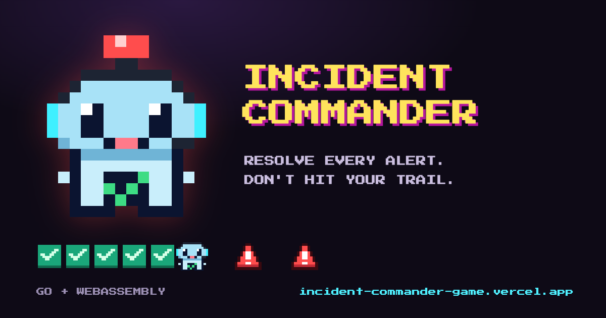
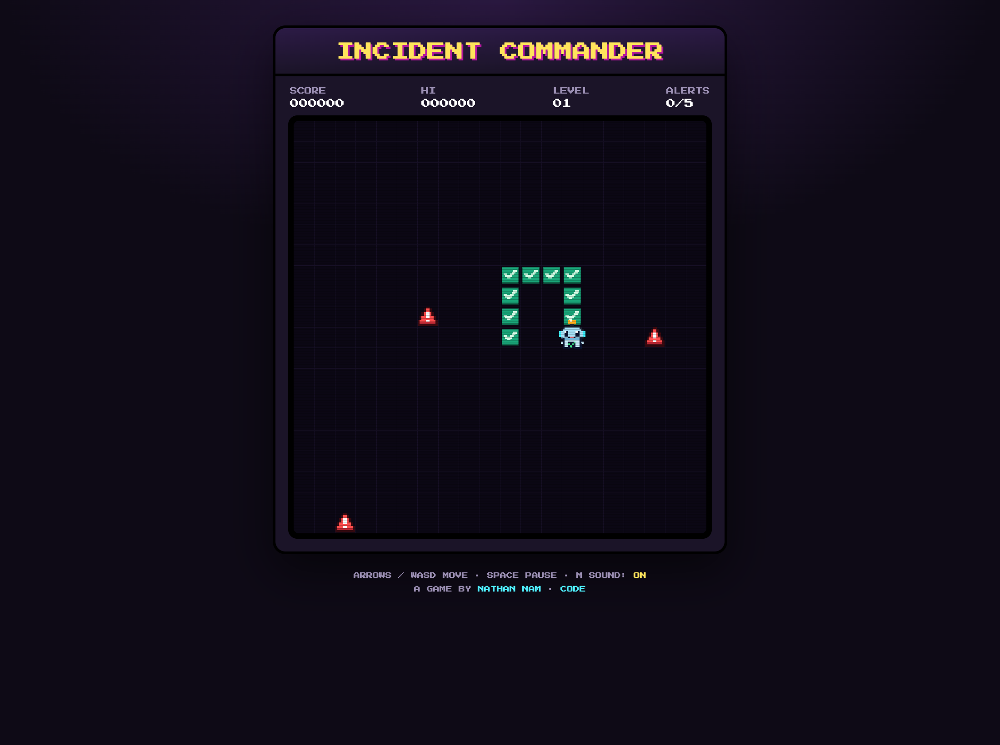
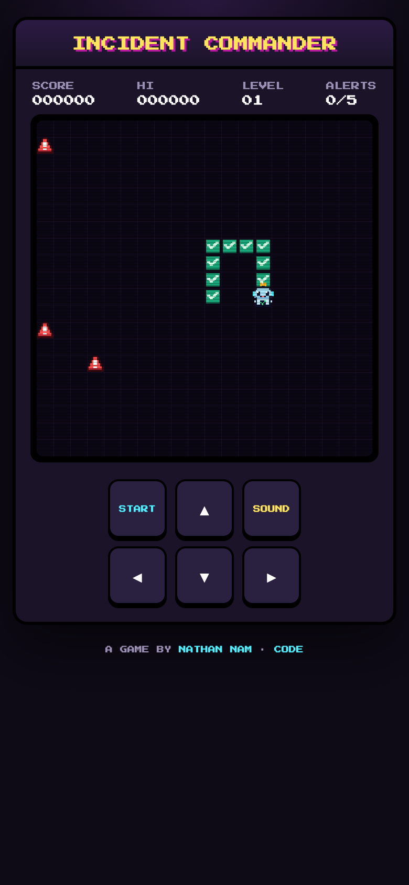

# Incident Commander



A retro arcade game about being on call. Steer the Incident Commander around the board, resolve every alert, and don't run into the trail of incidents you've already closed. Ten levels, each a little faster, with walls and mazes from level 3.

**Play:** https://incident-commander-game.vercel.app

<p>
  
  
</p>

## How to play

| | Desktop | Phone |
|---|---|---|
| Move | Arrow keys or WASD | Swipe on the screen, or the arrow buttons |
| Start / pause | Space, Enter or P | Tap the screen, or START |
| Sound: all → effects only → off | M | SOUND |
| Back to the start screen | R | |

- Each alert on a level is worth more than the last (10, 20, 30, …).
- Clearing a level adds 100 × the level number, plus up to 60 for finishing fast.
- Your best score and sound setting are saved in your browser.
- The music and sound effects are synthesised in the browser with Web Audio (`web/sound.js`): an original chiptune loop that speeds up each level, no audio files.

## How it works

The rules and the drawing are Go, compiled to WebAssembly. The page around it is plain HTML and JavaScript.

```
cmd/game/          WebAssembly entry point: game loop, and the bridge to the page (window.ic)
cmd/server/        tiny static file server for playing locally
internal/game/     rules: movement, collisions, scoring, levels (no browser code, unit-tested)
internal/renderer/ draws the board on a <canvas> through syscall/js
internal/sprites/  the pixel art (sprites.json), shared with the brand script
web/               the site Vercel serves: index.html, sound.js, game.wasm, wasm_exec.js, fonts, icons
scripts/brand/     draws the favicon and share image from the sprites, and the README screenshots
```

Go handles the board and sends each frame's numbers to the page (`ic.onFrame`) along with events like "collect" and "gameover" (`ic.onEvent`). The page handles controls, overlays, sound and the saved high score, and steers the game with `ic.control("up")` and similar calls.

## Develop

Needs Go 1.24 or newer.

```sh
make serve   # build the wasm and play at http://localhost:8080
make test    # game-rule tests + vet for the wasm build
make build   # rebuild web/game.wasm after changing Go code (commit it)
make brand   # favicon + share image (Chrome + puppeteer-core)
```

`web/game.wasm` is committed, so the site deploys as static files with no build step. Vercel serves `web/` (see `vercel.json`) and counts page views with Vercel Web Analytics.

## Credits

Game, pixel art and music by [Nathan Nam](https://www.nathannam.com); the hero is a pixel take on his on-call robot concept. Font: Press Start 2P (SIL Open Font License). Code under the Apache License 2.0 (see `LICENSE`).
